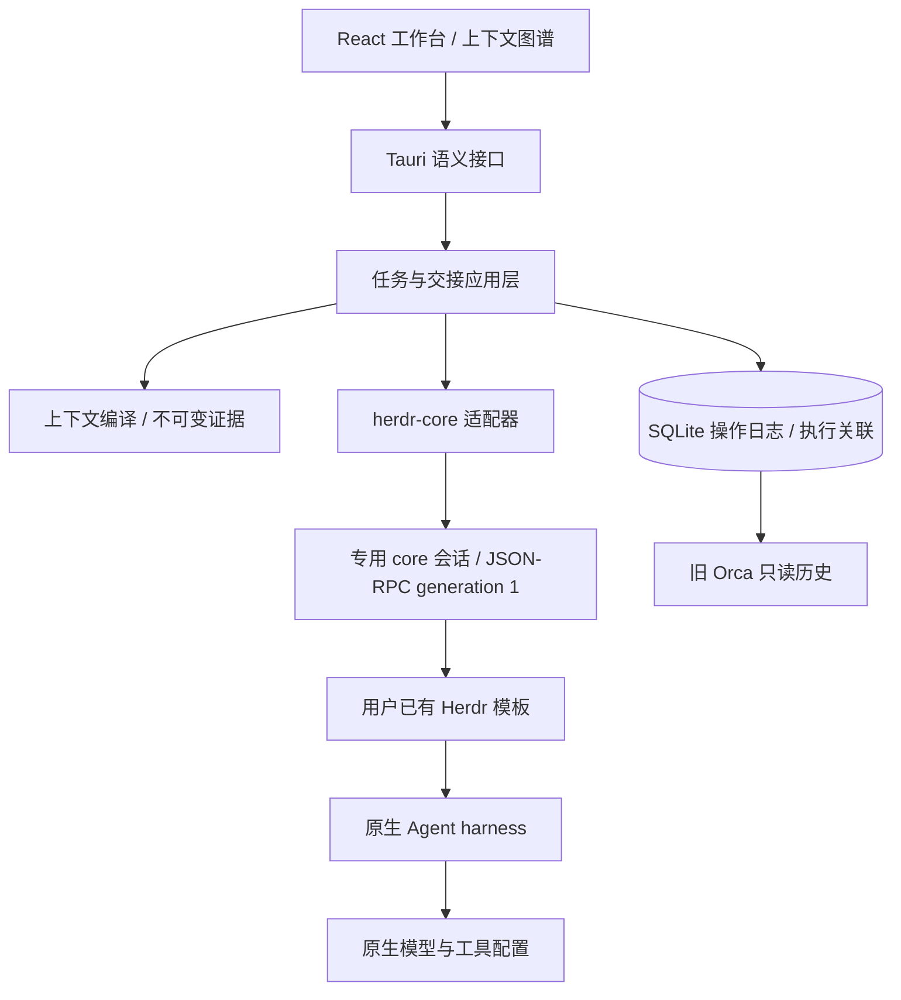

# 使用 herdr-core 作为 Agent 协作基座

2026-11-04 用户决定停止融合 Orca 底层能力，改用 herdr-core。本决定替代 ADR 0001 和 ADR 0003 中关于 Orca 所有权与执行路径的选择；保留其上下文、证据和未知结果原则。

ThoughtsFlow 拥有工作区、上下文图谱、Mission、任务交接、操作日志和执行尝试的本地关联。herdr-core 拥有持久终端、进程生命周期、原生模板解析、状态报告与消息投递。模板选择的 Agent harness 拥有模型、认证、工具、Skills、MCP 和审批。模型直连模块继续作为兼容功能，与 Agent 执行分离。

## 协议与任务语义

使用已核实的 herdr-core 0.1.17，固定提交 `ce87721557176f6cddaac1c7aefbf76929923263`。通过 `herdr-core connect` 的逐行 JSON-RPC 访问平台原生 socket/pipe，不把任务放到 shell 命令字符串，不引入第三方运行时 SDK。每个连接先核验 generation、稳定 core ID 和方法声明。端到端操作有超时和 4 MiB 回执上限。

检测只读取可执行文件版本；用户点击连接后，按需启动 `thoughtsflow` 专用 core 会话，继承用户的 Herdr 配置与模板。不会连接调用者继承的 HC_SOCKET 或 HC_TERMINAL_ID；应用退出不停止 core 或 Agent。恢复只重新核验原 core，不创建替代终端、不更换归属。

新任务选择原生模板，传 `argv: [templateName, exactHandoffText]`，由 core 在 Agent 就绪后投递首条消息。模型选择在模板/Agent 中完成，不扩展第二套 Provider 或认证生态。模板正文及 Agent 内部提示不归 ThoughtsFlow 的交接 hash 所有。预览冻结的是工作台输入与所请求的模板名；原生模板配置可能在外部改变，启动回执不证明实际模型用量。

派发先在同一 SQLite 事务中写入 pending 操作与不可变交接，再调用 core。只有准确的 core、终端地址、创建时间、Mission/Operation 标签、目录、模板和 `first_message.sent: true` 才确认任务提交。超时、回执不完整或首条消息未确认时保留 unknown，禁止用新操作 ID 重派。即便已知消息未发送，终端也可能已经存在，不能自动再启动。

状态分别表达：本地操作是否确认、终端 live/finished、Agent 自报 idle/working/done/blocked/error。`done` 显示“Agent 报告完成，待验收”，进程结束显示“执行已结束，结果待核实”；当前不实现自动验收或把退出码当作任务成功。只对明确 idle 的同一轮次提供指导输入，使用 `if: idle`、`force: false`；权限或信任对话继续在原生终端处理。

输出通过 `terminal.read(lines: 0)` 被动观察屏幕。历史读取可能向 TUI 发送滚动输入，因此本次不采用。屏幕不是可翻页转录；不制造 cursor。保存证据时同时保留读取前后身份与原始 RPC，并明确完整性边界。

## Git、旧数据与跨平台

herdr-core 不管理 Git worktree。新协作明确选择本地目录，任务在该目录运行，可能共享文件；需要隔离时由用户选定独立 checkout。当前是人工编排，不引入自动调度器、自动合并或隐式 worktree 创建。

schema 11 只新增 `agent_execution` 关联表。既有 Mission 缺少 runtimeBackend 时解释为 Orca，只读展示，不能交给 Herdr 重连或派发。旧 Context Receipt、交接、输出、原始回执、hash 及迁移 checksum 均保留。旧 DTO 中 runId/taskId/dispatchId 字段继续支持历史读取；Herdr 新记录的这些兼容字段引用本地 Mission/Operation，并不声称 core 提供了 Orca 式 Run/Task/Dispatch。

跨平台进程边界仍用 argv 和 stdin，Windows 不通过 cmd/bat 重解释任务正文。Herdr 模板自身依赖原生 shell；Windows 模板需要上游要求的 `sh`。macOS 的本次证据不能提升 Windows/Linux 实测状态。重连不会接管用户共享 core，也不会自动更新 core 或 Agent。

后续按真实需求增加事件订阅、原生 attach、显式任务验收和远程目录选择。会话树仍归原生 harness，不能用终端屏幕冒充模型上下文或完整会话恢复。
